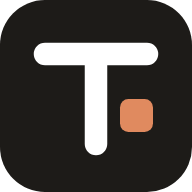
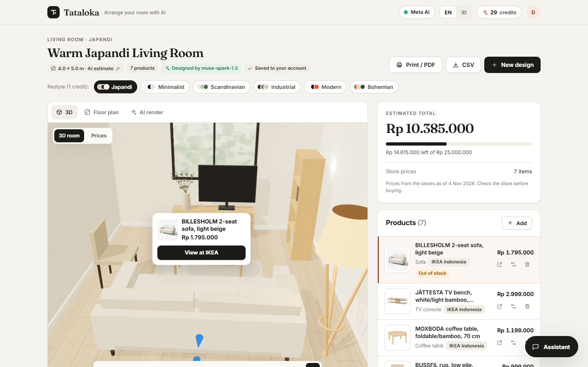
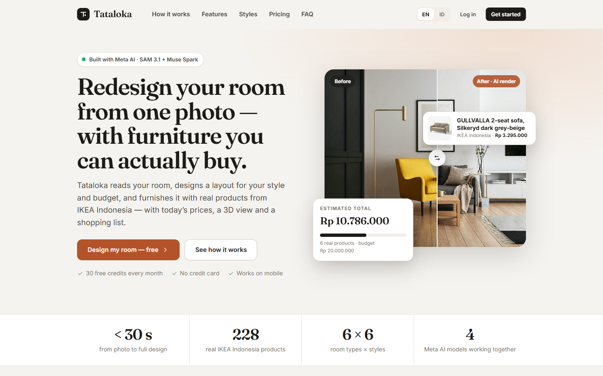
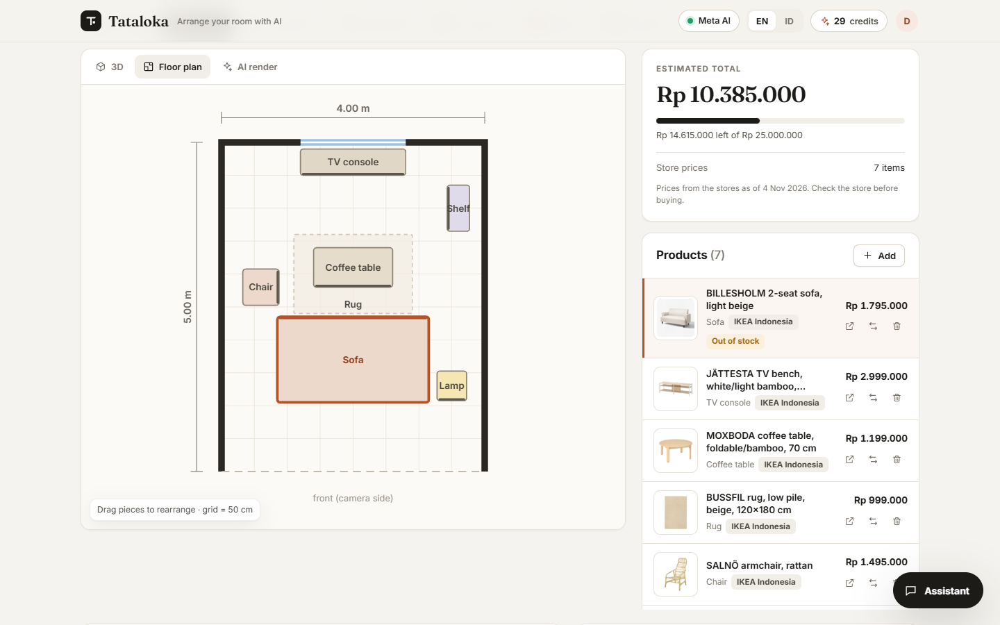
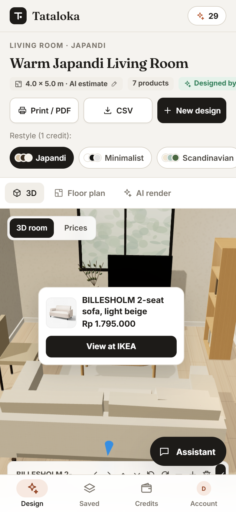
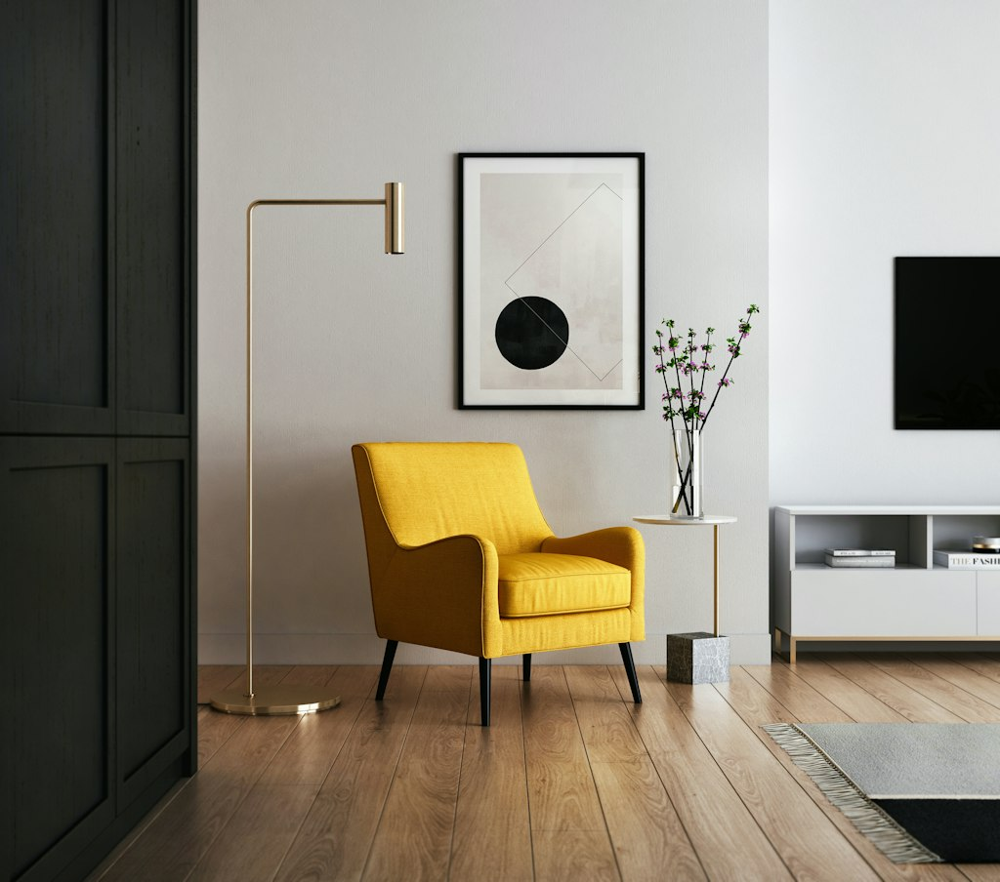
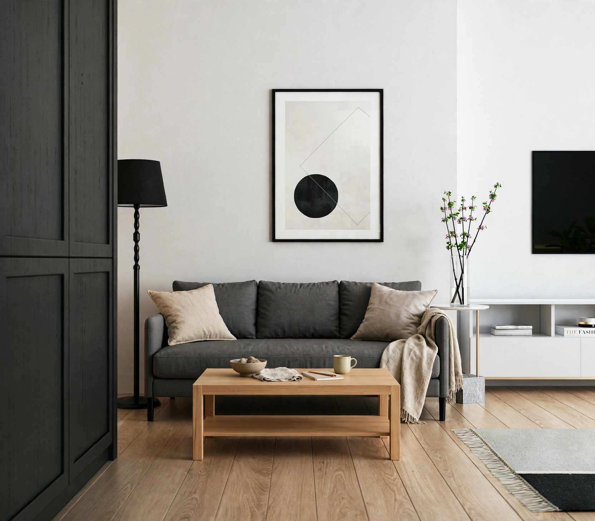
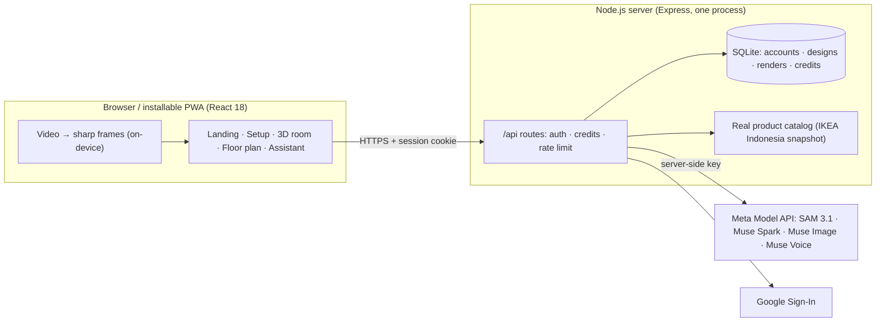

<div align="center">



# Tataloka

**Redesign your room from a photo or video — with furniture you can actually buy.**

An AI interior designer built on the **Meta Model API**. Tataloka reads your room, designs a layout for your style, size and budget, and furnishes it with **real IKEA Indonesia products and prices** — as a 3D room, a to-scale floor plan, a photoreal render of your own space and a shopping list.

[**Live app → www.tataloka.com**](https://www.tataloka.com) · [Architecture](docs/ARCHITECTURE.md) · [Pricing model](docs/PRICING.md) · [Demo guide](docs/DEMO_GUIDE.md)




</div>

> **Meta AI Hackathon entry.** Tataloka is built by an independent developer ([@mdlog](https://github.com/mdlog)) — product, design, engineering and deployment — on Meta's SAM 3.1, Muse Spark, Muse Image and Muse Voice models. It is live, multi-user and running in production at [www.tataloka.com](https://www.tataloka.com).

*Tataloka* comes from Indonesian **tata** (to arrange) and **loka** (place, space): *arrange your room with AI*.

---

## Contents

- [The problem](#the-problem)
- [What Tataloka does](#what-tataloka-does)
- [Features](#features)
- [Screenshots](#screenshots)
- [How the Meta Model API is used](#how-the-meta-model-api-is-used)
- [Real data, not mock data](#real-data-not-mock-data)
- [Architecture](#architecture)
- [Tech stack](#tech-stack)
- [Getting started](#getting-started)
- [Configuration](#configuration)
- [Scripts](#scripts)
- [Testing](#testing)
- [Deployment](#deployment)
- [Project structure](#project-structure)
- [Data, privacy and security](#data-privacy-and-security)
- [Credits and pricing](#credits-and-pricing)
- [Limitations and roadmap](#limitations-and-roadmap)
- [Acknowledgements](#acknowledgements)
- [License](#license)
- [Ringkasan (Bahasa Indonesia)](#ringkasan-bahasa-indonesia)

## The problem

Furnishing a room is a guessing game: Will that sofa fit? Which style works with what I already have? What will it all cost? Most AI room tools answer with a pretty image of furniture that does not exist — nothing in it can be measured, priced or bought.

Tataloka closes that gap for Indonesian homes: every piece in a design is a **real product** from a real store, with its **real size, photo, stock status and price**, placed in a room sized to **your** space.

## What Tataloka does

1. **Capture** — upload a photo, several photos, or a 10–20 s **video** of the room (the browser picks the sharpest frames on-device; the video is never uploaded). Optionally enter the size you measured with a tape.
2. **Understand** — **SAM 3.1** finds the floor, walls, windows, doors and existing furniture.
3. **Design** — **Muse Spark** reads every view and plans a layout for the chosen style, room size and budget, picking each piece from a shortlist of real catalog products (strict JSON schema). It explains the design and says which existing furniture to keep.
4. **Edit and preview** — rearrange furniture in a **3D room** or on a **to-scale floor plan**, swap or add products, restyle in one tap, and let **Muse Image** restyle *your own photo* for a before/after comparison.
5. **Shop** — a shopping list with store prices and product links, CSV export and a print-ready PDF design board.

## Features

**Real products and prices**
- 236-product catalog: 228 IKEA Indonesia products (official name, photo, price, SKU, stock) plus verified marketplace listings for items IKEA does not sell (toilets, bathtubs).
- Prices are dated and estimates are always labelled; furniture is scaled to each product's real dimensions.
- "Find on Tokopedia & Shopee" — live listings via Meta web search; only URLs the search engine actually returned are shown.

**Measurements you can trust**
- Room size is labelled *AI estimate*, *typical* or *measured*.
- Enter the measured width × length before designing, or correct it afterwards — furniture standing against a wall moves with that wall.
- Multi-view designs (up to 7 views from a video or several photos) let the model see every wall and the furniture you already own.

**Design tools**
- 3D room (Three.js) with drag-to-move, rotate and nudge controls and shoppable price tags; pinch-to-zoom on phones.
- To-scale SVG floor plan with a 50 cm grid.
- 6 styles (Japandi, Minimalist, Scandinavian, Industrial, Modern, Bohemian) × 6 room types; restyle in one tap.
- Budget meter, product swap/add from the catalog, design notes and moodboard.
- Text and voice assistant ("make it Scandinavian", "add a floor lamp") powered by Muse Spark and Muse Voice.
- Photoreal AI render saved with the design; print / PDF board that includes the render.

**A product, not a demo**
- Accounts with email + password or Google sign-in; designs and renders auto-save to *My designs*.
- Monthly AI credits with a transparent per-action cost and automatic refunds on failed calls.
- Installable mobile web app (PWA): bottom tab bar, bottom sheets, camera/video capture, safe-area aware.
- Bilingual (English / Bahasa Indonesia), marketing landing page with pricing, privacy policy and terms.

## Screenshots

| Landing page | Floor plan and shopping list | Phone (installable app) |
| :---: | :---: | :---: |
|  |  |  |

| Before (your photo) | After (Muse Image render) |
| :---: | :---: |
|  |  |

## How the Meta Model API is used

All model calls run **server-side**; the browser never sees the API key.

| Step | Model | Endpoint and technique | Measured (live) |
|---|---|---|---|
| Understand the photo | `sam-3.1` | `POST /v1/responses` (streaming), one text concept per call (floor, wall, window, door, sofa, …), 4 in parallel; box tokens parsed into regions | ~6 s for 10 concepts · ≈ $0.025 |
| Design + choose products | `muse-spark-1.3` | `POST /v1/chat/completions`, vision with **up to 7 images**, `json_schema` (strict) with `productId` from a real-product shortlist, `reasoning_effort: low`; measured sizes passed as exact constraints | ~20 s (1 photo) · ≈ $0.014 |
| Photoreal render | `muse-image-1.0` | `POST /v1/images/edits` on the user's photo, or `/v1/images/generations` | ~21 s · $0.01 |
| Voice commands | `muse-voice-transcribe-1.0` | `POST /v1/asr/transcribe`, push-to-talk 16 kHz WAV | ~2 s |
| Assistant intents | `muse-spark-1.3` | `POST /v1/chat/completions` with a strict command schema | ~5 s · ≈ $0.003 |
| Marketplace search | `muse-spark-1.3` + `web_search` tool | `POST /v1/responses`, `include: web_search_call.results`; URLs verified against raw results | ~5 s · ≈ $0.009 |

A full design from a photo costs about **4 US cents**. Changing style re-runs only Muse Spark (segmentation is reused). Unit economics: [docs/PRICING.md](docs/PRICING.md).

## Real data, not mock data

| Data | Source | How it is kept honest |
|---|---|---|
| Product catalog (228 IKEA items) | IKEA Indonesia product pages — schema.org `Product` data (name, photo, price, SKU, stock), URLs from the official sitemap | Only robots.txt-allowed paths, no query strings, polite rate; the catalog date is shown in the UI |
| Bathtubs and toilets (not sold by IKEA) | Tokopedia/Shopee listings found by Meta web search | The URL must appear in the raw search results; no price is guessed |
| Marketplace alternatives (live) | `/api/market-search` → Meta web search | Same URL verification plus a relevance filter, cached 24 h |
| Room analysis, layout, product choice | SAM 3.1 + Muse Spark on your photo/video frames | Strict JSON schema; product IDs validated against the catalog; positions clamped into the room |

During development the model invented a product URL that returned 404 when asked for links directly — which is why Tataloka never trusts model-written URLs or prices. Refresh the catalog any time with `npm run catalog:build` (≈3 minutes, a few cents of Muse Spark for style tagging).

## Architecture



- **One process** serves the API and the built app (`npm start`), or the API with Vite hot reload in development (`npm run dev`). `/` is the landing page, `/app` the design tool.
- The **design document** (`roomGraph`) is the single source of truth for the 3D room, floor plan, budget, shopping list, print board and saved designs.
- AI output is never trusted blindly: JSON is schema-validated, product IDs are resolved against the real catalog, positions are clamped into the room and overlaps resolved.

More detail: [docs/ARCHITECTURE.md](docs/ARCHITECTURE.md).

## Tech stack

| Layer | Technology |
|---|---|
| Frontend | React 18, Vite 6, Zustand, Three.js + React Three Fiber + drei, SVG floor plan, Web Audio (WAV capture), PWA manifest |
| Backend | Node.js ≥ 22.13, Express 4, built-in `node:sqlite`, scrypt password hashing, Google OAuth 2.0 (state + PKCE) |
| AI | Meta Model API — SAM 3.1, Muse Spark 1.3, Muse Image 1.0, Muse Voice Transcribe 1.0, web search tool |
| Hosting | InstaCloud (Singapore region) with a persistent volume, Cloudflare DNS and email routing, Docker (Node 24) |
| Quality | `node:test` suite with a fake Meta API (131 tests), live end-to-end check script |

## Getting started

**Prerequisites:** Node.js **22.13 or newer** (for the built-in SQLite) and a Meta Model API key. Without a key the app runs in a clearly labelled **demo mode**: designs are assembled from the same real catalog and the sample photo shows pre-labelled regions.

```bash
git clone https://github.com/mdlog/tataloka.git
cd tataloka
npm install
cp .env.example .env        # add META_API_KEY (get one at https://dev.meta.ai)
npm run check:api           # verifies the key and the four model IDs
npm run dev                 # → http://localhost:5173  (landing page; the app is at /app)
```

Production build:

```bash
npm run build
npm start                   # → http://localhost:5173 (or $PORT)
```

With Docker:

```bash
docker build -t tataloka .
docker run -p 8080:8080 --env-file .env -v tataloka-data:/data tataloka
```

Deep links from the landing page: `/app?style=Japandi&room=bedroom`, `/app?signup=1`, `/app?login=1`, `/app?designs=1`.

## Configuration

All settings are environment variables (see [`.env.example`](.env.example)). Secrets live only on the server.

| Variable | Required | Description |
|---|---|---|
| `META_API_KEY` | for live AI | Meta Model API key. Empty → demo mode. |
| `META_API_BASE` | no | API base URL (default `https://api.meta.ai/v1`). |
| `META_TEXT_MODEL`, `META_SEG_MODEL`, `META_IMAGE_MODEL`, `META_ASR_MODEL` | no | Model IDs (defaults `muse-spark-1.3`, `sam-3.1`, `muse-image-1.0`, `muse-voice-transcribe-1.0`). |
| `META_REASONING_EFFORT` | no | `minimal` · `low` (default) · `medium` · `high`. |
| `SAM_CONCEPTS` | no | Comma-separated concepts SAM 3.1 looks for (one call each). |
| `PORT` | no | HTTP port (default `5173`). |
| `RATE_LIMIT_PER_10MIN` | no | AI requests per account (or IP) per 10 minutes (default `60`, `0` = off). |
| `PUBLIC_URL` | for Google sign-in | Public origin of the app, e.g. `https://www.example.com`. |
| `ALLOWED_HOSTS` | no | Extra hostnames the app is served from (dev server and Google redirect). |
| `GOOGLE_CLIENT_ID`, `GOOGLE_CLIENT_SECRET` | optional | Enables "Continue with Google". Redirect URI: `<PUBLIC_URL>/api/auth/google/callback`. |
| `RESEND_API_KEY` | for email sign-ups | Sends the 6-digit verification email ([Resend](https://resend.com)); email + password accounts unlock AI after verifying. Without it, development prints the code to the console. |
| `MAIL_FROM` | no | Sender of the verification email (default `Tataloka <noreply@tataloka.com>`; the domain must be verified in Resend). |
| `DATA_DIR` | no | Folder for the SQLite database (default `./data`; `/data` in Docker). |
| `CREDITS` | no | Set to `off` to disable AI credits (the rate limit still applies). |

## Scripts

| Command | What it does |
|---|---|
| `npm run dev` | API + Vite dev server with hot reload |
| `npm run build` | Production build of the web app into `dist/` |
| `npm start` | API + built app (production) |
| `npm test` | Unit and integration tests |
| `npm run check:api` | Verifies the API key and model IDs |
| `npm run check:live` | Calls every live route once against the real API (costs a few cents) |
| `npm run catalog:build` | Rebuilds the IKEA Indonesia catalog snapshot (polite crawl of robots-allowed product pages) |
| `npm run credits -- <email> [--add N] [--plan free\|plus\|pro]` | Admin: balances, bonus credits, plans |

## Testing

```bash
npm test
```

131 tests run against an in-memory database and a **fake Meta Model API** that asserts the exact request shapes (strict JSON schema, Responses API streaming for SAM, multipart WAV for ASR, multi-image design requests). They cover the catalog, design normalization, layout and collision rules, measured sizes and resizing, video frame selection, authentication, credits and refunds, and saved designs and renders.

## Deployment

The production instance runs on **InstaCloud** as a single compute service with a persistent volume at `/data`, built from the included `Dockerfile` (Node 24). `.dockerignore` keeps `.env` and local data out of the build context; secrets are set on the service, never in the image.

```bash
insta deploy . --port 8080
printf '%s' "$VALUE" | insta secrets set META_API_KEY --service compute/app
```

The custom domain is attached as `www.tataloka.com` (DNS-only CNAME at Cloudflare) and the root domain redirects to it with a Cloudflare redirect rule. Any Node 22.13+ host or container platform works the same way: build, set the environment variables and mount a persistent volume for `DATA_DIR`.

## Project structure

```
server/                 Express app (one process)
  server.js             routes, validation, rate limit, static hosting / Vite dev middleware
  meta.js               Meta Model API client (SAM 3.1, Muse Spark, Muse Image, Muse Voice, web search)
  auth.js · db.js       accounts, sessions, Google OAuth (PKCE), SQLite schema and migrations
  credits.js            monthly credits, charging and refunds
  designs.js            saved designs and their AI renders, scoped per user
  retail.js             schema.org product parsing, verified marketplace links
src/
  main.jsx              routing: "/" landing page, "/app" design tool (lazy-loaded)
  App.jsx               design flow: setup → generating → results
  landing/              marketing landing page with pricing
  components/           Setup, Results, 3D RoomScene, FloorPlan, ProductList, Catalog, Assistant,
                        Credits, Account sheet, mobile tab bar, print board, room size
  lib/                  roomGraph (design document), roomLayout (geometry), prompts (schemas),
                        video (frame extraction), views, aiParse, API clients
  data/                 real product catalog, rooms, styles, plans and credit costs
scripts/                catalog builder, API checks, credits admin
tests/                  node:test suites with a fake Meta API
docs/                   architecture, pricing model, demo guide, screenshots
public/                 icons, PWA manifest, legal pages, sample photo
```

## Data, privacy and security

- **Room photos and videos are never stored.** Videos never leave the device — only a few still frames are sent to the model. AI renders are saved with the user's own design (visible only to them) and deleted with it.
- **No invented products or links.** Every catalog product links to its store page; marketplace links are shown only if the web search actually returned them; estimated prices are labelled.
- **Secrets stay on the server.** The Meta API key and OAuth secret are environment variables; the browser only talks to `/api/*`.
- **Accounts:** scrypt-hashed passwords; HTTP-only `SameSite=Lax` session cookies (Secure over HTTPS) with only a SHA-256 hash of each token stored; Google OAuth with state + PKCE; same-origin checks on state-changing requests; login attempt limiting.
- **Abuse protection:** per-account rate limit plus monthly AI credits charged before each model call and refunded if it fails.

Policies: [Privacy](https://www.tataloka.com/privacy) · [Terms](https://www.tataloka.com/terms) · Contact: info@tataloka.com

## Credits and pricing

Every account gets **30 free AI credits per month** (refilled on the 1st, Jakarta time):

| Action | Credits |
|---|---|
| Design from a photo (SAM 3.1 + Muse Spark) | 3 |
| Design from a video or several photos (up to 7 views) | 5 |
| Design without a photo, or restyle | 1 |
| Photoreal AI render | 1 |
| Tokopedia & Shopee search (repeats within 24 h are free) | 1 |
| Assistant (text & voice) | free while the account has credits |
| Editing, saving, exporting | free |

Paid plans (Plus Rp49.000 and Pro Rp129.000 per month) and top-ups are designed and shown on the pricing page as *coming soon*; see [docs/PRICING.md](docs/PRICING.md).

## Limitations and roadmap

- **Scale from images is an estimate.** A camera alone cannot know real size, so users can enter measured dimensions. Next: AR tap-to-measure on supported phones.
- **Payments are not connected yet.** Next: Midtrans/Xendit checkout and webhooks to activate Plus/Pro plans.
- **The catalog is a dated snapshot.** Prices and stock come from the store on the date shown — check the store before buying. Next: scheduled refreshes and more Indonesian retailers.
- **3D furniture is procedural**, scaled to each real product's footprint rather than an exact product model; "On my photo" overlays the 3D furniture without camera calibration.

## Acknowledgements

- [Meta Model API](https://dev.meta.ai) — SAM 3.1, Muse Spark, Muse Image and Muse Voice.
- Product data from [IKEA Indonesia](https://www.ikea.co.id) product pages, always linked back to the store.
- Sample room photo from [Unsplash](https://unsplash.com) (Unsplash License).
- Built for the **Meta AI Hackathon** by [@mdlog](https://github.com/mdlog), an independent developer.

## License

[MIT](LICENSE) © 2026 mdlog. Product names, photos and prices belong to their respective stores and are shown with links back to the original pages.

---

## Ringkasan (Bahasa Indonesia)

**Tataloka** adalah desainer interior AI yang dibangun di atas **Meta Model API** oleh developer indie ([@mdlog](https://github.com/mdlog)) untuk **Meta AI Hackathon**. Pengguna cukup mengunggah foto atau merekam video ruangan: **SAM 3.1** mengenali lantai, dinding, jendela, dan furnitur; **Muse Spark** menyusun desain sesuai gaya, ukuran ruangan, dan budget memakai **produk IKEA Indonesia yang benar-benar dijual** lengkap dengan harganya; hasilnya bisa diedit di **3D** dan **denah berskala**, dilihat langsung di foto ruangan sendiri lewat **Muse Image**, lalu dibelanjakan lewat daftar belanja.

Aplikasi sudah live di **https://www.tataloka.com**, lengkap dengan akun (email/Google), desain tersimpan, kredit AI bulanan, tampilan mobile yang bisa dipasang seperti aplikasi, dan dua bahasa (Indonesia/Inggris).

Menjalankan secara lokal: `npm install` → salin `.env.example` ke `.env`, isi `META_API_KEY` → `npm run dev` → buka **http://localhost:5173**.
